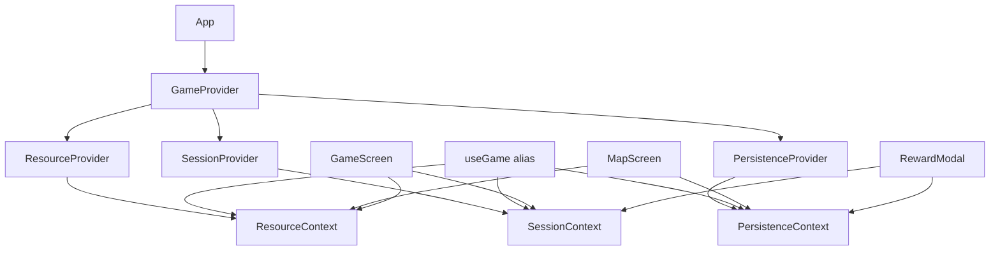

# Design Document: GameContext Refactor

## Overview

Mevcut `GameContext.tsx` tek bir 600+ satırlık context blob'udur. Her state değişimi tüm consumer bileşenleri yeniden render etmekte; cleanup eksiklikleri bellek sızıntısı yaratmakta; `playerSave` ve `levelStats` iki ayrı localStorage anahtarı kullanmakta; `play`/`haptic` callback'leri stale closure riski taşımaktadır.

Bu tasarım `GameContext`'i üç slice'a böler, cleanup güvenliğini sağlar, save katmanını migration destekli hale getirir ve stabil callback pattern'ini tanımlar. Tüm değişiklikler geriye dönük uyumlu tutulur; `useGame` alias'ı migration tamamlanana kadar çalışmayı sürdürür.

---

## Architecture

```
src/
  store/
    contexts/
      ResourceContext.tsx     <- coins, hints, multiplier, owned items
      SessionContext.tsx      <- aktif oturum: letters, found, streak, timer...
      PersistenceContext.tsx  <- completed levels, mastery, collected words...
    GameProvider.tsx          <- slice'lari birlestiren kok bilesen
    GameContext.tsx           <- useGame alias (geriye donuk uyumluluk)
  game/
    playerSave.ts             <- PlayerSave v2: levelStats dahil + migration
    cleanup.ts                <- createCleanupRegistry yardimci fonksiyonu
```



---

## Components and Interfaces

### ResourceContext

```typescript
type ResourceState = {
  coins: number;
  hintsRemaining: number;
  coinMultiplier: number;
  ownedShopItems: string[];
  coinPulse: boolean;
};

type ResourceActions = {
  pulseCoins: () => void;
  addCoins: (amount: number) => void;
  spendCoins: (amount: number) => boolean; // false -> yetersiz
  spendHint: () => boolean;                // false -> hint ve coin yetersiz
  addHints: (count: number) => void;
  setCoinMultiplier: (value: number) => void;
  addOwnedItem: (itemId: string) => void;
  isItemOwned: (itemId: string) => boolean;
};
```

**Consumer'lar:** `TopBar`, `ResourcePill`, `ShopScreen`, `HintModal`

---

### SessionContext

```typescript
type SessionState = {
  level: LevelData;
  letters: string[];
  selected: number[];
  found: string[];
  hiddenFound: WordEntry[];
  revealedLetters: Record<string, number[]>;
  meaning: WordEntry | null;
  feedback: Feedback;
  streak: number;
  maxStreak: number;
  usedHint: boolean;
  earnedObjectives: ObjectiveKey[];
  sealOpen: boolean;
  elapsedTime: number;
  complete: boolean;
  currentWord: string;
  levelTransitionKey: number;
  modal: Modal;
  toast: string;
};

type SessionActions = {
  startLevel: (level?: LevelData) => void;
  goToNextLevel: () => void;
  submitWord: (word: string) => void;
  handlePointerDown: (index: number) => void;
  handlePointerMove: (clientX: number, clientY: number) => void;
  handlePointerUp: (clientX?: number, clientY?: number) => void;
  handlePointerCancel: () => void;
  findLetterAtPoint: (clientX: number, clientY: number) => number | null;
  clearSelection: () => void;
  shuffleLetters: () => void;
  revealMeaningHint: () => void;
  revealLetterHint: () => void;
  setModal: (modal: Modal) => void;
  setToast: (message: string) => void;
  submitCurrentWord: () => void;
  play: (name: SfxName) => void;
  haptic: (pattern: number | number[]) => void;
};
```

**Consumer'lar:** `GameScreen`, `WordPuzzle`, `RewardModal`, `HintModal`

---

### PersistenceContext

```typescript
type PersistenceState = {
  completedLevels: number[];
  awardedLevels: number[];
  levelMastery: Record<number, LevelMastery>;
  collectedWords: WordEntry[];
  favoriteWords: string[];
  levelStats: Record<number, LevelStats>;
  dailyChallenge: DailyChallenge | null;
  soundEnabled: boolean;
  hapticsEnabled: boolean;
};

type PersistenceActions = {
  isLevelUnlocked: (candidate: LevelData) => boolean;
  markLevelCompleted: (levelId: number) => void;
  markLevelAwarded: (levelId: number) => void;
  mergeMastery: (levelId: number, objectives: ObjectiveKey[]) => void;
  addCollectedWord: (entry: WordEntry) => void;
  toggleFavorite: (word: string) => void;
  setSoundEnabled: (value: boolean) => void;
  setHapticsEnabled: (value: boolean) => void;
  updateStats: (levelId: number, time: number, streak: number) => void;
  claimDailyReward: () => void;
};
```

**Consumer'lar:** `MapScreen`, `LevelModal`, `DictionaryScreen`, `ProfileScreen`, `SettingsScreen`

---

### Audio/Haptic — Stable Ref Pattern

Mevcut `play` ve `haptic` stale closure tasıyor cunku `soundEnabled`/`hapticsEnabled` dogrudan capture ediliyor. Duzeltme:

```typescript
// SessionContext icinde:
const soundEnabledRef = useRef(soundEnabled);
const hapticsEnabledRef = useRef(hapticsEnabled);

// render body'de (effect degil, dogrudan atama):
soundEnabledRef.current = soundEnabled;
hapticsEnabledRef.current = hapticsEnabled;

const play = useCallback((name: SfxName) => {
  playSfx(name, soundEnabledRef.current);
}, []); // bos dep array — ref uzerinden okur, referans stabil kalir

const haptic = useCallback((pattern: number | number[]) => {
  if (!hapticsEnabledRef.current) return;
  if ('vibrate' in navigator) navigator.vibrate(pattern);
}, []);
```

`soundEnabled` ve `hapticsEnabled` `PersistenceContext`'te yasarken, `SessionContext` bunlari prop olarak alir ve ref'e yazar.

---

### Cleanup Registry Pattern

```typescript
// src/game/cleanup.ts
export function createCleanupRegistry() {
  const timeouts = new Set<number>();
  const intervals = new Set<number>();
  let rafHandle: number | null = null;

  function safeTimeout(fn: () => void, ms: number): number {
    const id = window.setTimeout(() => {
      timeouts.delete(id);
      fn();
    }, ms);
    timeouts.add(id);
    return id;
  }

  function safeInterval(fn: () => void, ms: number): number {
    const id = window.setInterval(fn, ms);
    intervals.add(id);
    return id;
  }

  function clearSafeInterval(id: number) {
    window.clearInterval(id);
    intervals.delete(id);
  }

  function safeRaf(fn: () => void): void {
    if (rafHandle !== null) window.cancelAnimationFrame(rafHandle);
    rafHandle = window.requestAnimationFrame(() => {
      rafHandle = null;
      fn();
    });
  }

  function flushAll() {
    timeouts.forEach(window.clearTimeout);
    timeouts.clear();
    intervals.forEach(window.clearInterval);
    intervals.clear();
    if (rafHandle !== null) {
      window.cancelAnimationFrame(rafHandle);
      rafHandle = null;
    }
  }

  return { safeTimeout, safeInterval, clearSafeInterval, safeRaf, flushAll };
}
```

Her context slice, kendi `cleanup` instance'ini `useRef` ile tutar ve unmount'ta `flushAll()` cagirir.

---

## Data Models

### PlayerSave v2

`levelStats` tek save key'e tasınır; `version: 2` olarak guncellenir:

```typescript
export const CURRENT_SAVE_VERSION = 2;

export type PlayerSave = {
  version: 2;
  currentLevelId: number;
  coins: number;
  completedLevels: number[];
  awardedLevels: number[];
  collectedWords: string[];
  favoriteWords: string[];
  soundEnabled: boolean;
  hapticsEnabled: boolean;
  levelMastery: Record<number, LevelMastery>;
  ownedShopItems: string[];
  hintsRemaining: number;
  coinMultiplier: number;
  levelStats: Record<number, LevelStats>; // YENİ: soz-stats-v1'den tasindi
};
```

### Migration Pipeline

```typescript
type RawSave = Record<string, unknown>;

function migrateV1ToV2(raw: RawSave): RawSave {
  let levelStats: Record<number, unknown> = {};
  try {
    const statsRaw = localStorage.getItem('soz-stats-v1');
    if (statsRaw) levelStats = JSON.parse(statsRaw);
  } catch { /* skip */ }
  return { ...raw, version: 2, levelStats };
}

const MIGRATIONS: Record<number, (raw: RawSave) => RawSave> = {
  1: migrateV1ToV2,
};

export function migratePlayerSave(raw: unknown): PlayerSave {
  let data = ((raw != null && typeof raw === 'object') ? raw : {}) as RawSave;
  let detectedVersion = typeof data.version === 'number' ? data.version : 1;
  while (detectedVersion < CURRENT_SAVE_VERSION) {
    const migFn = MIGRATIONS[detectedVersion];
    if (!migFn) break;
    data = migFn(data);
    detectedVersion++;
  }
  return sanitize(data); // mevcut sanitize mantigi
}
```

Migration sonrasi `soz-stats-v1` anahtari silinir.

---

## Correctness Properties

*A property is a characteristic or behavior that should hold true across all valid executions of a system — essentially, a formal statement about what the system should do.*

---

**Property 1: Render Isolation**
*For any* change to `SessionContext` state that does not touch `ResourceContext` fields, components that consume only `ResourceContext` shall not be re-rendered.
**Validates: Requirements 1.3, 2.1**

---

**Property 2: Cleanup on Unmount**
*For any* component using the cleanup registry that registers a `safeTimeout`, when `flushAll` is called before the timeout fires, the callback shall not execute.
**Validates: Requirements 3.1**

---

**Property 3: Stable Audio/Haptic Callbacks**
*For any* value of `soundEnabled` (true or false), calling `play` after toggling `soundEnabled` shall invoke `playSfx` with the current value of `soundEnabled`, not the value at the time `play` was created.
**Validates: Requirements 4.1, 4.4**

---

**Property 4: Migration Validity**
*For any* raw object with `version: 1` (or no version field), `migratePlayerSave(raw)` shall return a `PlayerSave` where `version === 2` and no previously present valid field is lost.
**Validates: Requirements 5.2, 5.5**

---

**Property 5: PlayerSave Round-Trip**
*For any* valid `PlayerSave` object, `loadPlayerSave` applied to the result of `persistPlayerSave` shall return an object deeply equal to the original.
**Validates: Requirements 7.1, 7.2, 7.3**

---

**Property 6: earnedObjectives Reset**
*For any* non-empty `earnedObjectives` array, calling `startLevel` shall result in `earnedObjectives` being an empty array.
**Validates: Requirements 6.1, 6.3**

---

## Error Handling

| Scenario | Behavior |
|---|---|
| `localStorage.getItem` throws | `try/catch` ile yakalanir, default save donerr |
| `localStorage.setItem` quota exceeded | `try/catch` ile sessizce gozardi edilir |
| Migration: unknown version | Dongu kirilir, mevcut data sanitize edilir |
| `useResource`/`useSession`/`usePersistence` outside provider | `Error` firlatir |
| `startLevel` with pending reward timer | Timer iptal edilir, yeni oturum temiz baslar |

---

## Testing Strategy

**Dual approach:** unit testler ornek ve hata durumlarini; property testleri evrensel ozellikleri kapsar.

**Property-based testing library:** `@fast-check/vitest` + `fast-check`

```bash
npm install --save-dev @fast-check/vitest fast-check
```

Her property testi minimum 100 iterasyon; tag formati:
```
// Feature: game-context-refactor, Property N: <text>
```

| File | Test Type | Coverage |
|---|---|---|
| `playerSave.test.ts` | Unit + Property | Round-trip, migration, sanitize |
| `cleanup.test.ts` | Property | safeTimeout/flushAll |
| `ResourceContext.test.tsx` | Unit | addCoins, spendCoins, spendHint |
| `SessionContext.test.tsx` | Unit + Property | startLevel reset, stable play |
| `PersistenceContext.test.tsx` | Unit | isLevelUnlocked, mergeMastery |
| `GameContext.test.tsx` | Unit | render isolation |
